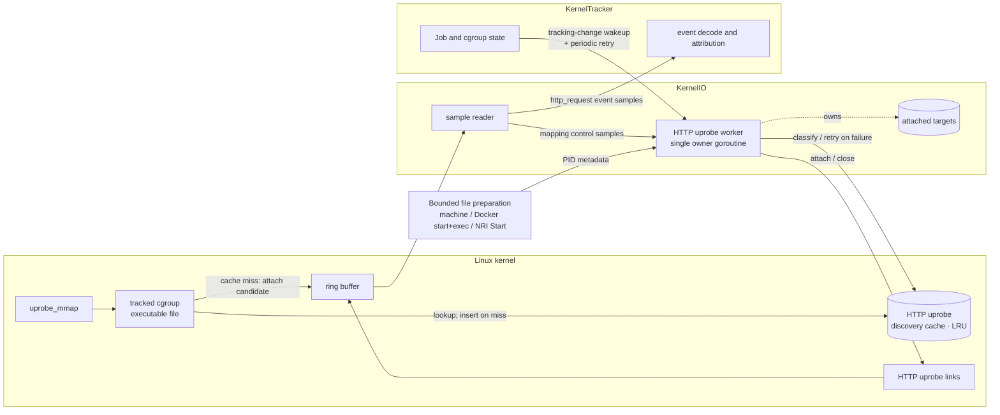
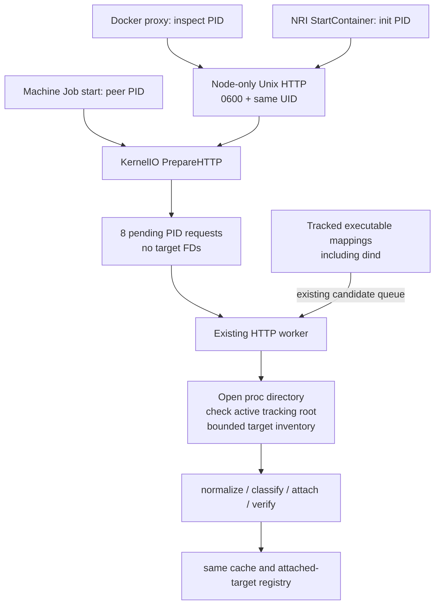
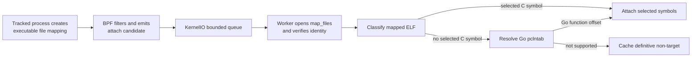
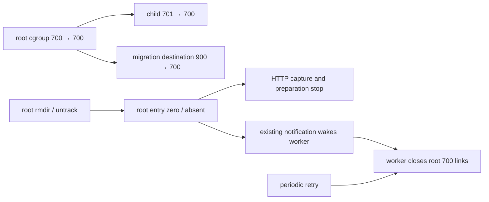

# HTTP Uprobe Runtime

This chapter defines the userspace-library HTTP capture runtime: why it exists,
how it discovers and attaches uprobes, how requests become events, and how
attachments are reclaimed. Cleartext HTTP capture at `tcp_sendmsg` uses the same
`http_request` event but does not use this discovery lifecycle.

Cleartext HTTP, OpenSSL HTTP/1.x, nghttp2 HTTP/2, and Go `net/http` HTTPS
capture are implemented. All `http_request` sources remain disabled by default
while first-request timing and environment compatibility are evaluated. Enable
them together with `--enable-http-request=true`.

## Reading this implementation

A uprobe observes calls to a function in a userspace program. Attaching means
registering that observation; the retained link lets the worker remove it later.
OpenSSL and nghttp2 are usually separate shared-library files, while `gh` and
`glab` usually contain the relevant Go code in their executable. Preparation
therefore looks for `libssl.so` and `libssl.so.*` files, not the `openssl` command.

### Finding a container's files from its PID

A Linux container's programs are also processes on the node. A PID identifies a
process, and `/proc/PID/root` provides access to that process's filesystem view,
including its mounts, when permissions allow it. Here, root means the filesystem
root `/`, not the root user. For example, after opening `/proc/1234/root`, the
scanner can look inside `usr/lib` as process 1234 sees it. The PID supplies the
entry point; the scanner still needs the bounded directory and filename list.
See the Linux [`proc_pid_root(5)`](https://man7.org/linux/man-pages/man5/proc_pid_root.5.html) documentation.

PIDs can have different numbers in different PID namespaces. Docker inspect
reports the daemon's numbering, so `Process.OpenProc` uses that daemon's `/proc`
view and checks it before interpreting the container PID. This avoids depending
on Docker's private storage-directory layout.

### Library directory names and links

Debian-style multiarch directories distinguish CPU/ABI-specific libraries:
`x86_64-linux-gnu` for amd64 and `aarch64-linux-gnu` for arm64 in this scanner.
These names are often called triplets; `architectureDirName` names their role in
`inventoryDirectories`. Selection follows the Agent's architecture, not a scan
of each container's executable architecture.

A normal symlink points to another pathname. A procfs magic link such as
`/proc/PID/fd/7` can instead refer directly to a file held by a process. Candidate
lookup rejects these with `RESOLVE_NO_MAGICLINKS` and keeps normal symlinks inside
the selected root with `RESOLVE_IN_ROOT`. This restriction applies *after* the
runtime-supplied `/proc/PID/root` entry point has been opened intentionally.

### Sending the PID instead of files

The observer sends a process number to the Agent. The Agent's worker opens that
process's `/proc/PID` directory, reads its cgroup membership, and looks for the
known files below its root. The worker opens and closes every target itself;
no target file descriptors cross processes or wait in the preparation queue.

Holding the proc directory prevents subsequent path lookups from selecting a
reused PID. It does not freeze the process's root, cgroup membership or file
contents. A PID already stale before that first open remains a best-effort hint:
the Agent only prepares a currently tracked cgroup, never a root ID supplied by
the caller. Backing checks remain necessary for overlay copy-up.

## Purpose and scope

Network destination alone is not always enough to identify a malicious action.
An upload to `github.com`, for example, can use a legitimate domain while sending
credentials or artifacts to an attacker-controlled repository. A `domain` event
can also be absent when a process resolves names through DNS over HTTPS, leaving
`network_connect` with only an IP address.

`http_request` adds method, query-stripped path, host, capture source, and process
identity. These fields create more detection and investigation points for
operations that otherwise share the same destination.

There is no universal capture point for every HTTP request. TLS and HTTP
implementations expose plaintext at different functions, some binaries do not
retain attachable symbols, and HTTP/2 or HTTP/3 can encode a request before a
generic write function sees it. Complete coverage is therefore not a design
claim. The design does not treat avoidable capture gaps as acceptable: each
supported function path should attach as early as practical, and measured misses
should drive additional catch-up mechanisms when their benefit justifies the
cost.

`http_request` is a supplemental signal, not a complete egress record. Its
absence does not prove that no HTTP or network communication occurred.

## Architecture

HTTP uprobe discovery is part of the [eBPF Runtime](../ebpf-runtime.md). KernelIO
owns kernel-facing resources and one HTTP uprobe worker. KernelTracker owns Jobs,
tracked cgroups, process context, and event attribution.



For each executable file mapping, BPF checks the root/file LRU cache and inserts a key on a
miss before emitting an attach candidate. Reclaim closes ended-root links; positive cache entries are removed with links; negative entries expire through the bounded LRU. Transient work failure and a
full worker queue also remove the entry so a later mapping can retry.

KernelTracker requests a periodic reclaim check. KernelIO also wakes the worker
on cgroup removal and tracked-map deletion; the worker reads the kernel tracking
map itself, so child inheritance need not wait for userspace notification. Lifecycle adapters separately request preparation
of a small predefined inventory. They own no classification or uprobe links.

The worker serializes preparation, attach candidates, and reconciliation on one
goroutine. No other goroutine reads or mutates its attached-target state, so
classification, attach, and close do not require a mutex. KernelIO separately
serializes loop startup and teardown so closing the Agent cannot race goroutine
registration. Starts after close and duplicate starts are rejected.

### Preparation entry points and ownership

Preparation registers probes on existing files before a later function call.
It does not require the target program to be running, but it does require access
to the actual file that the workload will map. A host copy of an image library
is not a substitute for the container's file.

| Environment | Preparation window | Files available at that window | Remaining gap |
| --- | --- | --- | --- |
| Machine | Successful Job start | Fixed host inventory | Files installed later or outside that inventory |
| Host Docker through the proxy | Before forwarding a later exec start | Files in the already-running container's root | Initial entrypoint; files created by the exec itself |
| GitLab Docker executor through the proxy | After dockerd starts the container, before returning success to Runner | Files in the running container's root | Entrypoint code already runs; only scripts sent after the response benefit |
| containerd CRI/runc with NRI | `StartContainer`, before task start | Waiting init process's root | Later exec has no NRI preparation callback |
| dind inner workloads | No inner-daemon preparation | Discovered through tracked executable mappings | Initial calls may precede attachment; host proxy/NRI cannot see inner lifecycle requests |



Runtime adapters select the process and timing. They neither open target files
nor parse ELF, store links, or create Job state. The worker owns the entire file
lifetime. The node-only socket remains Agent-owned and is never mounted into
Jobs. KernelTracker forwards preparation to KernelIO without its event reactor.

| Read in this order | Responsibility |
| --- | --- |
| `internal/agent/httpprepare/preparation.go`, `transport_linux.go` | Send PID metadata using standard Unix HTTP; authenticate node-side producers |
| `internal/agent/kerneltracker/kernelio/http_preparation_linux.go` | Queue PIDs; open proc/inventory in the worker; share attachment with mapping discovery |
| `internal/agent/httpprepare/process_linux.go`, `inventory_linux.go` | Pin the proc directory and open bounded target names under its root |
| `internal/agent/kerneltracker/kernelio/http_uprobe_attach_linux.go` | Shared classification, attachment, verification and registry commit |
| `internal/agent/kerneltracker/kernelio/http_uprobe_mmap_linux.go` | Confirm backing identities before parsing and after registration |
| `internal/agent/kerneltracker/kernelio/http_uprobe_worker.go` | Serialize work and reclaim ended-root links |

### Retained runtime state

| Type | State | Purpose and identity | Access | Bound and removal |
| --- | --- | --- | --- | --- |
| Worker-owned registry | `attachedTargets` (`attachedUprobeTarget` entries) | Keyed by tracking root cgroup ID and backing `mappedFileIdentity` (device, inode); stores classification key and links | HTTP uprobe worker only | 4,096 root/file targets; reclaimed after the root leaves tracking |
| Shared BPF cache | `http_uprobe_discovery_cache` | Keyed by root cgroup ID and `fileClassificationKey` (device, inode, ctime); suppresses callbacks for files already queued, classified, or attached | BPF hook, KernelIO reader, and worker | 65,536-entry LRU; transient failures remove entries for retry; positive entries are removed on link close; negatives expire through eviction |

The cache is notification suppression, not the link registry. Eviction can cause
another classification, but it cannot detach or lose a link. `attachedTargets`
remains the source of truth for attached links.

A kernel uprobe observes a file and offset across processes. Each retained link
here additionally carries its tracking root cgroup ID as an attach cookie. Every HTTP
uprobe BPF entry compares that cookie with the calling cgroup's root ID before
parsing or emitting an event.

## Discovery and attachment

### Discovery model

Mapping notification is the primary discovery path. It reacts when a process in
a tracked cgroup receives a new executable file mapping, before the selected
library function is called.

This also covers mappings created by later Jobs and containers on long-lived
self-hosted or Kubernetes runners, provided their cgroup is already tracked.
ELF inspection and attachment still run asynchronously in userspace, so the
selected function can run first and the initial request can be missed.

Each candidate carries a `fileClassificationKey` made from backing device,
inode, and ctime. Ctime is a generation hint, not a guarantee against concurrent
in-place modification. Overlay-visible `fstat` identities are not canonical.

Bounded preparation improves the first-request window for known common files.
All other files keep using mapping discovery. There is no open/write trigger,
periodic attach scan, recursive workspace scan, or image/snapshot parser.

### Bounded preparation

| Target | Resolution | Inventory below the selected root |
| --- | --- | --- |
| `libssl.so`, `libssl.so.*` | Defined ELF function symbols | `/lib`, `/lib64`, `/usr/lib`, `/usr/lib64`, `/usr/local/lib`, `/usr/local/lib64`, and the host architecture's `/lib` and `/usr/lib` multiarch directories |
| `libnghttp2.so`, `libnghttp2.so.*` | Defined ELF function symbols | Same library directories |
| `gh`, `glab` | Go pclntab | `/bin`, `/usr/bin`, `/usr/local/bin` |

Successful machine Job-start requests refresh the bounded host inventory.
Agent startup does not scan. Runtime PATH, command and tool-cache metadata are
not inspected; binaries elsewhere remain mapping-discovered.
Docker proxy preparation runs before forwarding a later `/exec/{id}/start`,
and, for GitLab only, after a successful `/containers/{id}/start` response arrives from dockerd,
before returning that response to the caller. At the latter point the container
is already running and its PID/root can be inspected. GitLab Runner's ordinary
Docker executor sends shell stdin only after `ContainerStart` returns, so this
prepares known files before that script. It does not stop an entrypoint that
runs independently of stdin. Existing container-create cgroup staging is unchanged.
GitHub job-container steps normally use Docker exec; Docker container actions
and service entrypoints do not wait for an exec gate.
Both paths share container inspect, the daemon's verified PID/procfs view, and
the same PID preparation API. No script/stream parsing or buffering is added. Containers bypassing the proxy
remain mapping-discovered. The proxy requires the existing systemd cgroup driver and stages `docker-ID.scope`.
The daemon must be local to the proxy; TCP-only remote Docker endpoints do not
expose a verifiable process root. dind inner workloads use existing
cgroup propagation and mmap discovery only. The host Docker proxy does not see
inner daemon API requests. Inner-proxy deployment and inner-workload
pre-attachment are outside the supported preparation paths.

The NRI observer prepares known CI containers at `StartContainer`, using the
waiting init PID's root. On the supported containerd CRI/runc path, this callback
is between task creation and task start. It does not imply notifications for
later exec operations. Reconnect does not prepare existing containers or replay
missed Job staging. Mapping discovery observes future executable mappings; it
does not replay files already mapped before an Agent restart.
It also requires an actively tracked cgroup: restarting the Agent does not
restore existing Job tracking, so future mappings alone cannot recover those
Jobs. New containers staged after restart use the normal preparation path.

Inventory uses `openat2(RESOLVE_IN_ROOT | RESOLVE_NO_MAGICLINKS)` so absolute
container symlinks resolve inside the selected root, including library directory
symlinks. Executables use six fixed path probes. In each of at most eight library
directories, inventory matches the patterns above against at most 4,096 names
without recursion. It reads one extra name to detect overflow, then opens only
matching candidates. This is a resource bound, not a measured optimum; files
beyond the limit can miss preparation because directory order is unspecified.
It retains at most 32 FDs. Custom paths, excess entries and late-installed files use
mapping discovery. Prepared files remain attached for their cgroup tracking
lifetime, including a delayed first use. There is no preparation grace timer.

Preparation attaches to the file object, not to its pathname. Replacing a file
at the same path after preparation does not transfer its probes to the new
inode, even when the replacement has identical contents. A later executable
mapping discovers the replacement and queues attachment through the existing
worker; the first selected call can precede that attachment. This is an accepted
coverage limit. Preparation does not watch file updates or block execution until
replacement files are attached.

All producers call `PrepareHTTP` with a PID and, for Docker, a daemon PID to
interpret its namespace. Remote callers use standard HTTP over the Agent-owned
Unix stream socket `<agent-socket>.http-preparation`, mode `0600`, with same-owner
`SO_PEERCRED` validation. It is separate from Job-facing routes and never mounted
into Jobs. The request carries numeric process identifiers, not paths or root IDs.
The Agent reads membership in its own cgroup namespace and resolves the ID
against its configured cgroup mount. The observer needs no proc-root read
capability, extra cgroup mount, or namespace-changing privilege.

The 500 ms caller deadline covers Docker inspect when needed, request delivery,
queueing, inventory and attachment waiting. Workloads continue on timeout,
queue saturation, missing files or attachment failure. Docker inspect can run
even if HTTP preparation is unavailable; its context bounds the request.

The queue holds at most eight metadata requests and no target FDs. The single
worker holds at most 32 inventory files plus its local proc/membership and
attachment handles. Expired queued requests are skipped. An in-flight filesystem
syscall or link close can outlive the deadline and delay other attachment work;
only this worker performs it, so blocked filesystem goroutines do not multiply.
The server uses standard HTTP cancellation and read/header/write timeouts; there is
no custom FD protocol, producer admission layer or queued-FD shutdown drain.
The eight-entry queue is a resource budget, not a measured optimal concurrency.

Normal mapping samples and event delivery keep their existing queues. Mapping
discovery and reconciliation are serviced between preparation batches. Between target closes it yields to pending
preparation or mapping work; an idle sweep drains eligible targets. Individual
close latency is measured because kernel unregister cannot be preempted.

### Backing identity

PID preparation and mapping discovery use different ways to open a candidate,
not different canonical file identities. The proxy sends only process metadata.
The worker opens preparation candidates below the process root; mapping discovery
opens the notified VMA through `map_files`. Neither FD's raw `fstat` identity is
used as the attached-target key. Both paths use `mapFile` to obtain the backing
identity, and mapping candidates additionally compare it with the notification.

The existing `uprobe_mmap` hook reports the backing identity of a temporary
one-page read-only mapping made by the worker. ELF and Go resolvers use normal
FD reads. After attaching selected offsets, the worker reopens `/proc/self/fd/FD`
and normalizes again. If that lookup now resolves to a different backing or
generation, the result is rejected and provisional links are closed. The mapping
is never read by userspace. The worker-request branch and normal executable-map
discovery read `vm_file->f_inode` with the same `http_uprobe_inode_key` helper;
the worker-request branch fills its request map entry without emitting a
discovery event.

Obtaining a backing identity does not convert the input into a backing-only FD.
This is why post-attachment verification remains necessary. It is also not a
watch on the original pathname: a pathname replacement can leave an already-open
FD referring to the old file. Later mappings of the replacement discover its new
identity independently.

Both discovery paths use the same worker, root/file cache, and root/inode
registry. A completed negative classification differs from a queued notification.
Before work and before committing a result, the worker checks that the cgroup
still belongs to its active tracking root. That root ID is also the attach
cookie checked by each HTTP uprobe entry program. An end racing with the final
userspace check makes that cookie inactive immediately; reclaim closes any
remaining link later.

Reclaim checks the tracking root, independently of file mapping lifetime. The
mmap hook is required for file identity; failure to attach it fails HTTP
initialization rather than substituting visible overlay inode numbers.

#### Synchronous mmap query

The worker uses one `http_uprobe_mmap_requests` hash map, with at most one entry.
The same entry carries the request and response:

```text
worker: LockOSThread
worker: requests[PID/TID] = empty file identity
worker: mmap one read-only page
    BPF: find requests[current PID/TID]
    BPF: fill the empty identity from vm_file->f_inode
worker: mmap returns; read requests[PID/TID]
worker: require a nonzero inode; delete the entry; UnlockOSThread
```

`LockOSThread` keeps the goroutine on one OS thread and prevents other goroutines
from running on that thread. The Agent's host PID/TID numbering must match
`bpf_get_current_pid_tgid`. The fentry program runs during the worker's syscall,
so the worker can look up the result after mmap returns; no event receiver or
polling loop is involved. A completed result is not overwritten by later hook
calls. Every request starts empty, so an unread result cannot become the next
query's success. Lookup, mmap, or missing-result failures abort preparation.

This protocol assumes no unrelated file mapping runs on the marked thread before
the intended mmap. Thread locking does not mask native signal handlers; it is
not a general proof against same-thread reentry. The Agent builds without cgo,
and does not deliberately perform another file mapping in that interval. This
assumption is distinct from file-content mutation or overlay copy-up. Ordinary
mapping discovery still uses the ring buffer because the workload does not wait
for the userspace worker.

See [Go's LockOSThread contract](https://pkg.go.dev/runtime#LockOSThread) and
[Linux BPF map access](https://docs.kernel.org/bpf/maps.html).

These checks do not make concurrent file-content writes atomic. In particular,
a provisional link can execute before post-attachment validation rejects it.
Unusual concurrent mutations can therefore affect observation during that short
window. The invariant is that a mismatching result is not retained under the
wrong file key; it is not a universal race-free filesystem snapshot.

Primary lifecycle references: [Linux uprobes](https://github.com/torvalds/linux/blob/v6.8/kernel/events/uprobes.c),
[Linux proc maps](https://github.com/torvalds/linux/blob/v6.8/fs/proc/task_mmu.c),
[GitLab Runner start/STDIN ordering](https://gitlab.com/gitlab-org/gitlab-runner/-/blob/v18.10.1/executors/docker/internal/exec/exec.go),
and [containerd CRI start](https://github.com/containerd/containerd/blob/v2.2.0/internal/cri/server/container_start.go).

Mapping notification is also not limited to dynamically linked libraries. A
statically linked executable, including a Go binary, creates executable file
mappings when it starts. The same discovery trigger therefore feeds both ELF
symbol lookup and the Go-specific pclntab resolver.

The implemented attach path is:



### Kernel-side candidate filtering

`fentry/uprobe_mmap` receives a completed VMA and its backing file. The BPF
program emits an attach candidate only when all of these conditions hold:

- the VMA is executable and file-backed;
- the current cgroup has a nonzero HTTP tracking root cgroup ID;
- the file is not already queued, classified, or attached according to
  `http_uprobe_discovery_cache`.

One ELF can create several executable VMAs. Dedup therefore uses the root/file key
above rather than the VMA range or process identity. Filtering and dedup stay in
BPF because the kernel already has these values and rejecting a candidate there
avoids a ring-buffer sample and userspace work.

The attach candidate contains discovery metadata only. It carries no HTTP bytes
or file content.

### Userspace classification and attach

The KernelIO sample reader recognizes an HTTP uprobe attach candidate and puts it
on a bounded, non-blocking worker queue. Attach candidates do not enter
KernelTracker, Job attribution, or CEL evaluation.

The worker handles each candidate serially:

1. Open the mapped file through `/proc/<pid>/map_files`, normalize its backing
   identity, and compare it with the sample. A changed backing is not cached.
2. Look for selected C functions in `.symtab` and `.dynsym`. If none are
   defined, try the Go pclntab resolver described in
   [Go net/http Uprobes](go-http-uprobes.md).
3. Attach resolved file offsets, verify the registration backing, store their
   links as one attached target, and keep the discovery-cache entry.
4. If neither resolver finds a supported function, keep the cache entry.
5. On a transient failure or queue drop, remove the cache entry so a later
   mapping can retry.

## Event capture and delivery

Attachment prepares a capture point; it does not emit an event. A later call to
an attached function enters the existing security-event path.

```mermaid
flowchart LR
    CALL["Tracked process calls<br/>selected function"]
    UPROBE["uprobe BPF entry"]
    GATE["tracking root cgroup ID = attach cookie"]
    PARSE["bounded in-kernel parse"]
    SAMPLE["http_request sample"]
    READER["KernelIO reader"]
    TRACKER["KernelTracker<br/>decode and Job attribution"]
    JOB["Job worker<br/>CEL and output"]

    CALL --> UPROBE --> GATE --> PARSE --> SAMPLE --> READER --> TRACKER --> JOB
```



### Capture points

| Function | Protocol path | Input contract | Source |
| --- | --- | --- | --- |
| [`SSL_write`](https://docs.openssl.org/master/man3/SSL_write/) | OpenSSL HTTP/1.x | plaintext buffer is argument 2; length is argument 3 | `openssl` |
| [`SSL_write_ex`](https://docs.openssl.org/master/man3/SSL_write/) | OpenSSL HTTP/1.x | same input-buffer argument positions | `openssl` |
| [`nghttp2_submit_request`](https://nghttp2.org/documentation/nghttp2_submit_request.html) | nghttp2 HTTP/2 | `nghttp2_nv` array is argument 3; count is argument 4 | `nghttp2` |
| [`nghttp2_submit_request2`](https://nghttp2.org/documentation/nghttp2_submit_request2.html) | nghttp2 HTTP/2 | same relevant argument positions | `nghttp2` |
| [`net/http.(*Transport).roundTrip`](go-http-uprobes.md) | Go `net/http` HTTPS, HTTP/1.x and HTTP/2 | pclntab resolves the function; a recognized stack check selects the capture point before ABIInternal argument 2 changes | `go_net_http` |

Selected functions with the same argument and parsing contract share one BPF
entry.

The OpenSSL path reads an HTTP/1.x request line and `Host` before encryption.
The nghttp2 path reads `:method`, `:path`, and `:authority` before HPACK encoding.
The Go path reads `http.Request` and `url.URL` before protocol encoding. All
produce the same event shape.

### Event and redaction contract

| Field | Value |
| --- | --- |
| `method` | request method, normalized to lowercase for rule evaluation |
| `path` | origin-form request path, with query excluded by the BPF capture, then normalized to lowercase |
| `host` | HTTP/1.x `Host`, HTTP/2 `:authority`, or Go `Request.Host` / `URL.Host`, normalized to lowercase; a port can remain |
| `source` | `openssl`, `nghttp2`, or `go_net_http` |
| `process` | KernelTracker process snapshot for the caller |

Raw request bytes, query parameters, other headers, and bodies do not cross the
kernel boundary. This is the redaction invariant.

## Link lifetime and reclaim

The tracking root's **cgroup ID** determines link lifetime. A directly bound root
stores its own ID in `tracked_cgroups`; a staged container does so when
`cgroup_mkdir` supplies its ID. Children and newly tracked migration destinations
inherit that value. Existing destinations keep their own root. There is no
Agent-allocated owner number, tracking generation, or retired-root history.



`cgroup_rmdir` clears the value before emitting its existing notification, so even
if the ring buffer drops it, the root cannot remain HTTP-active. The entry stays
for the existing late-event attribution grace. KernelIO wakes the HTTP worker on
that notification and on explicit tracked-map deletion. The periodic wakeup
retries missed notifications. Reclaim checks each target's root entry directly;
it does not scan all cgroup values or require a coherent snapshot.

A child deletion does not close its root's links. A root deletion does, even if a
process migrated elsewhere and remains alive. The HTTP BPF gate checks both the
calling cgroup's root ID and the root entry itself. This lifetime policy does not
change KernelTracker's general event attribution or Job finalization.

One shared image file can have independent links for roots A and B. Closing A's
links leaves B's registration intact. Only the registration whose cookie matches
the caller's active root parses the call. The worker prevents duplicate
(root cgroup ID, backing device, inode) targets. No event-content cache discards
legitimate repeated requests; dispatch overhead still grows with registrations.

| State | Action |
| --- | --- |
| Root maps to itself | Keep targets, including files not yet mapped by a Job. |
| Root entry zero or absent | Close its links and remove each link's positive discovery-cache entry. |
| Root lookup fails | Keep links and retry on another wakeup. |
| Preparation/candidate queue has work | Yield between target closes, keeping a reclaim wakeup. |
| Agent shutdown | The same worker closes remaining links; metadata requests own no FDs. |

Preparation checks root activity before work and before committing links. If
removal happens after that check, the BPF root gate stops new captures and the
worker later closes the link. A handler already executing at removal may finish;
this is not a synchronous drain of events. No filesystem or link syscall runs
inside the cgroup notification reader.

The key uses the kernel's full 64-bit cgroup ID, not its pathname. Recreating a
cgroup at the same path creates a different identity; Linux kernfs incorporates
ID rollover into that value ([Linux 5.15 allocation](https://github.com/torvalds/linux/blob/v5.15/fs/kernfs/dir.c#L591)).
Assigning successive Jobs to the same still-existing cgroup is not given a
separate HTTP lifetime by this design. Negative classifications may stay in the
65,536-entry LRU: they describe file identity plus ctime and own no links. Ended
queued candidates clear their pending entries. No full cache walk is needed.

Reclaim reads neither process maps nor container files. Mapping discovery may
still read `/proc/maps` to recover a merged VMA address range; the opened file is
verified against its BPF backing identity. A long-lived root can retain more
files until that root ends; the 4,096-target cap bounds this retention.

Moving into an independently tracked root does not discover its existing VMAs;
that root needs preparation or later mapping discovery. General tracking and
Job attribution notification-loss limits also remain.

## Coverage

Coverage is defined by an observed function path, not by a tool name. A client is
verified only when a reproducible real-client E2E produces the expected source
and request fields. `Not covered (verified)` means the same environment was
tested and did not call a selected function.

Verified rows below use GitHub-hosted Ubuntu 22.04, 24.04, and 26.04 preview on
x64 and arm64 unless noted otherwise.

| Workload | Status | Observed path |
| --- | --- | --- |
| curl over HTTPS HTTP/1.1 | Verified | `SSL_write` |
| Python `urllib.request`, requests, and pip over HTTPS HTTP/1.x | Verified | `SSL_write_ex` |
| Node and npm over HTTPS HTTP/1.x | Verified | `SSL_write` |
| wget over HTTPS HTTP/1.x | Verified on 22.04 and 24.04 | `SSL_write`; Ubuntu 26.04 preview uses GnuTLS and is not covered. |
| Git over HTTPS HTTP/1.x | Not covered (verified) | GitHub-hosted Ubuntu uses a GnuTLS-backed Git HTTP helper. |
| curl and Node over HTTPS HTTP/2 | Verified | selected nghttp2 request API |
| Git over HTTPS HTTP/2 | Verified | selected nghttp2 request API for default negotiation and explicit `http.version=HTTP/2` |
| GitHub CLI (`gh api`) | Verified | `net/http.(*Transport).roundTrip` |
| GitLab CLI (`glab`) | Verified in the Linux 6.8 arm64 fixture, real GitLab Docker jobs, and GKE COS amd64 runtime fixture | `net/http.(*Transport).roundTrip`; full ARC/GitLab Kubernetes deployment matrix pending. |
| Java or rustls-based HTTPS | Not covered | Does not call a currently selected function. |
| Python `h2` / httpx HTTP/2 | Not covered | Does not use nghttp2 for request submission. |

## Operational status and known limits

- `http_request` capture is disabled by default during rollout. The
  `--enable-http-request` switch controls both the cleartext tap and the HTTP
  uprobe runtime, and remains the disable path after default enablement.
- Mapping notification precedes the selected function call, but ELF
  classification and attachment are asynchronous. The function can run before
  its uprobe is attached, so the initial request can be missed. This is an
  accepted coverage limit of asynchronous discovery.
- Preparation improves common existing files only. Workspace downloads,
  replacement after preparation, root/target-cap saturation, and Docker
  initial entrypoints can still lose the first request. Dind inner workloads
  use mapping discovery only; inner-proxy preparation is outside the supported preparation paths.
- Discovery observes executable mappings created while the process is already in
  a tracked cgroup. Initial catch-up scanning, periodic attach backstop, moving an
  existing process into a tracked cgroup, and later `mprotect(PROT_EXEC)` are not
  current discovery paths.
- C library capture requires a selected function in `.symtab` or `.dynsym`.
  Go capture accepts only the pclntab layouts and ABI/object-layout range listed
  in [Go net/http Uprobes](go-http-uprobes.md).
- HTTP/1.x parsing starts at one write boundary. A split request line or `Host`
  outside the bounded prefix can be missed.
- HTTP/2 is visible only before HPACK in a selected nghttp2 API. Other HTTP/2
  implementations and HTTP/3/QUIC are not parsed.
- The nghttp2 parser examines at most 32 pseudo-headers and requires `:method`
  and an origin-form `:path`. Standard CONNECT has no `:path` and is not emitted;
  extended CONNECT can be emitted but `:protocol` is not exposed.
- The nghttp2 tap drops methods longer than 15 bytes and paths longer than 255
  bytes. A missing, invalid, or oversized `:authority` produces an empty host.
- Retries can produce duplicate events. Capture is not exactly once.

### Kernel implementation notes

Root filtering uses `bpf_get_attach_cookie`, available on the Linux 5.15 baseline
for perf-event uprobes. See [Linux's helper dispatch](https://github.com/torvalds/linux/blob/v5.15/kernel/trace/bpf_trace.c)
and [cilium/ebpf's UprobeOptions](https://github.com/cilium/ebpf/blob/v0.20.0/link/uprobe.go).
A cookie is a userspace-assigned number, not a kernel pointer or a JobIdentity.
The three entry programs gate before reading HTTP fields; tail-call stages and
rule/event schemas are unchanged.

Root liveness uses two bounded hash lookups, without new kernel structure reads
or writer atomics. Existing CO-RE cgroup/inode reads and the Linux 5.15 helper
baseline remain; no new kfunc or BPF loop is needed. The HTTP programs need a
cookie gate because they parse selected client functions directly, rather than
using a generic tracing-policy dispatcher.

The worker reads `/proc/PID/cgroup` in the Agent's cgroup namespace, as defined by
[`proc_cgroup_show`](https://github.com/torvalds/linux/blob/v6.8/kernel/cgroup/cgroup.c#L5869).
The observer supplies process metadata; the worker resolves membership.
